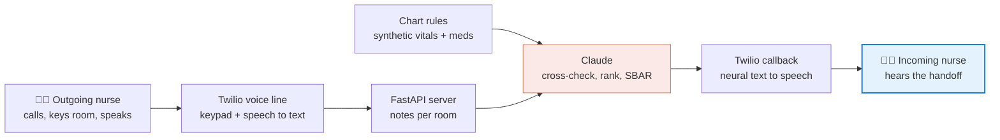

<div align="center">

# 📞 Voice Shift Handoff

**Nurses tell each other what they remember. This tells them what the chart says they missed.**

A phone-only shift handoff for hospital nurses: speak your handoff into a call, and the incoming nurse
gets a call back with a prioritized summary that flags where your words and the chart disagree.
No app. No login. No screen.


*Built solo in under 5 hours at **c0mpiled-16: UC San Diego** · Invisible Interfaces challenge, "No App" track*

</div>

---

## The problem

At every shift change, nurses hand off their patients verbally in a few rushed minutes. What gets said
doesn't always match the chart: a patient described as "stable" whose blood pressure has climbed three
readings in a row, or antibiotics "on schedule" when the evening dose was never documented. Those gaps
are exactly what the incoming nurse inherits.

**Who it's for:** inpatient bedside nurses, especially the incoming nurse taking over a patient
assignment. They carry a phone all shift; they don't have time to open another app.

## What it does

1. **The outgoing nurse calls one number**, keys in a room number, and talks through each patient.
2. **Chart rules check the record**: rising vitals, fever, low oxygen, and medications due but not documented.
3. **Claude cross-checks the spoken notes against the chart flags**, ranks patients by urgency, and writes
   a structured SBAR handoff (Situation, Background, Assessment, Recommendation).
4. **The incoming nurse's phone rings** and they hear the handoff, discrepancies first, in about 45 seconds.

> *"Two of your three patients need attention. Room twelve. Reported stable, but blood pressure has risen
> three readings in a row, now 152. Recheck vitals and notify the provider…"*

## Architecture



| Layer | Choice | Why |
|---|---|---|
| Interface | Twilio Programmable Voice | Every nurse already has a phone; nothing to install |
| Server | FastAPI | Small, fast webhook handlers |
| Chart checks | Deterministic Python rules (`rules.py`) | Explainable and auditable; no black box deciding what's abnormal |
| Reasoning | Claude | Reconciles messy speech with structured flags; never invents clinical facts |
| Output | Outbound call with neural TTS | The handoff reaches the nurse; the nurse doesn't go looking for it |

**Design principle:** rules decide *what is abnormal*; the model decides *how to say it*. Every flag in
the handoff traces back to a specific vital sign or medication record.

## Run it locally

```bash
git clone https://github.com/<your-username>/voice-shift-handoff.git
cd voice-shift-handoff
python3 -m venv .venv && source .venv/bin/activate
pip install -r requirements.txt
cp .env.example .env            # add Anthropic + Twilio keys
python rules.py                 # sanity check: flags rooms 12 and 14
uvicorn app:app --port 8000
ngrok http 8000                 # new terminal; put the https URL in .env as PUBLIC_URL, restart uvicorn
```

Point your Twilio number's **"A call comes in"** webhook to `https://<ngrok>/voice` (HTTP POST).
On a Twilio trial account, verify the callback phone under Verified Caller IDs.

**Try it without speaking:** `curl -X POST https://<ngrok>/demo/trigger` runs a canned handoff and places the callback.

## Project structure

```
├── app.py            # Twilio webhooks, Claude prompt, outbound callback
├── rules.py          # deterministic chart checks (vitals trends, fever, SpO2, missed meds)
├── patients.json     # synthetic patients for rooms 12, 14, 17
├── demo_notes.json   # canned spoken handoff for the backup demo
└── .env.example      # configuration template
```

## Safety and privacy

- **All patient data is synthetic.** No real protected health information was used.
- Recommendations are limited to nursing scope (recheck, verify with pharmacy, notify the provider). The model is instructed never to suggest drugs or doses.
- If the model fails, the incoming nurse still gets the raw notes read aloud. The handoff never silently disappears.
- A production version would need HIPAA-compliant hosting, a business associate agreement with each vendor, and an EHR integration in place of `patients.json`.

## Background

This builds on my winning project at the **American Statistical Association NYC Metropolitan Area hackathon**
(with AI4Purpose): an LLM-based platform that processed patient data to surface trends and anomalies for
clinicians. Voice Shift Handoff takes that same idea, catching what humans miss in clinical data, and moves
it off the screen and into the phone call nurses are already making.

## What's next

- Live EHR integration through FHIR instead of synthetic JSON
- Per-unit rule sets (ICU vs. med-surg thresholds)
- Read-back confirmation from the incoming nurse, logged for accountability
- Spanish and Tagalog handoffs for multilingual nursing staff

---

<div align="center">

Built by **Ron** · UC San Diego Data Science · [LinkedIn](https://linkedin.com/in/<your-handle>) · [Kaggle](https://www.kaggle.com/tommydeth)

</div>
